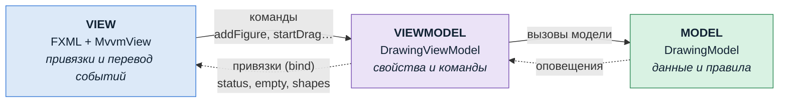

# MVVM: следующий шаг после MVC

Материал для тех, кто уже сделал лабораторную «JavaFX 2» по MVC и хочет разобраться глубже.
Пример кода — из проекта `javafx-shapes-mvc`, пакет `shapes.mvvm`.

---

## 1. Что неудобно в нашем MVC

Посмотрите на `MainController`:

```java
private void refresh() {
    drawingView.render(model.getItems());
    statusLabel.setText("Фигур: " + model.size() + "   |   " + lastAction);
}
```

И на то, что пришлось бы дописать, чтобы кнопка «Очистить» блокировалась на пустом холсте:

```java
clearButton.setDisable(model.size() == 0);   // и не забыть вызвать в refresh()
```

Контроллер **вручную** переносит каждое значение из модели в элементы окна. Чем больше на экране надписей, флажков и блокировок, тем длиннее `refresh()` и тем легче что-то забыть.

Вторая проблема: логику контроллера нельзя проверить без окна. Ему нужны настоящие `Label`, `Canvas` и `MouseEvent`.

MVVM решает обе проблемы.

---

## 2. MVVM за одну минуту

**MVVM = Model, View, ViewModel.**

| Часть | Что делает | Что знает |
|---|---|---|
| **Model** | данные и правила (та же, что в MVC) | ничего об интерфейсе |
| **ViewModel** | «модель экрана»: всё, что нужно показать, в виде **наблюдаемых свойств**, и **команды**, которые может вызвать экран | знает Model, **не знает View** |
| **View** | разметка и **привязки** (binding) элементов к свойствам ViewModel | знает ViewModel |

Ключевой механизм — **привязка данных**. View говорит «текст этой надписи всегда равен свойству `status`», и дальше JavaFX сам обновляет надпись при каждом изменении свойства.



Сплошные стрелки показывают, кто кого знает и вызывает: **только в одну сторону**, View → ViewModel → Model. Пунктирные — данные, которые приходят обратно автоматически, по подписке: ViewModel не держит ни одной ссылки на элементы окна, а модель не знает о ViewModel.

### Аналогия

В MVC контроллер — это **секретарь**, который сам бегает и переписывает цифры на доску объявлений после каждого изменения.
В MVVM ViewModel — это **табло** с цифрами, а View — **экраны в зале**, подключённые к табло проводом. Табло не знает, сколько экранов к нему подключено. Цифра на табло изменилась — все экраны показали новую сами.

---

## 3. Привязки в JavaFX: всё уже есть

Вы видели это в теме «Свойства и привязки»:

```java
statusLabel.textProperty().bind(viewModel.statusProperty());     // надпись = свойство
clearButton.disableProperty().bind(viewModel.emptyProperty());   // кнопка заблокирована, пока пусто
```

Свойства и наблюдаемые коллекции лежат в модуле `javafx.base` и работают **без запуска окна**. Поэтому ViewModel можно тестировать обычным JUnit.

---

## 4. Переход от MVC к MVVM на нашей задаче

### Шаг 0. Модель не трогаем

`DrawingModel`, `ShapeItem`, `FigureFactory`, `geometry2d` остаются без изменений. Если модель была хорошо отделена в MVC, переход на MVVM её не затрагивает. Это проверка того, что MVC был сделан правильно.

### Шаг 1. Всё, что показывается на экране, превращаем в свойства ViewModel

| Было в MVC (контроллер) | Стало в MVVM (ViewModel) |
|---|---|
| `statusLabel.setText(...)` в `refresh()` | `ReadOnlyStringWrapper status` |
| `clearButton.setDisable(...)` (пришлось бы писать) | `BooleanBinding empty = Bindings.isEmpty(shapes)` |
| `model.getItems()` в `refresh()` | `ObservableList<ShapeItem> shapes` |
| `canvas.getWidth()` при создании фигуры | `DoubleProperty areaWidth`, к нему привязан размер холста |

```java
public class DrawingViewModel {
    private final ObservableList<ShapeItem> shapes = FXCollections.observableArrayList();
    private final ReadOnlyStringWrapper status = new ReadOnlyStringWrapper();
    private final BooleanBinding empty = Bindings.isEmpty(shapes);
    private final DoubleProperty areaWidth = new SimpleDoubleProperty(600);
    private final DoubleProperty areaHeight = new SimpleDoubleProperty(400);

    public DrawingViewModel(DrawingModel model, FigureFactory factory) {
        this.model = model;
        this.factory = factory;
        model.addListener(this::syncFromModel);      // модель изменилась -> обновить свойства
        syncFromModel();
    }

    private void syncFromModel() {
        shapes.setAll(model.getItems());
        status.set("Фигур: " + model.size() + "   |   " + lastAction);
    }

    public ReadOnlyStringProperty statusProperty() { return status.getReadOnlyProperty(); }
    public BooleanBinding emptyProperty() { return empty; }
    // ...
}
```

`ReadOnlyStringWrapper`: внутри ViewModel свойство можно менять, а наружу отдаётся версия только для чтения. View не сможет записать в статус что-то своё.

### Шаг 2. Обработчики превращаем в команды без типов интерфейса

В MVC контроллер принимал `MouseEvent`. Во ViewModel команды получают **простые значения**:

| Было в MVC | Стало в MVVM |
|---|---|
| `onMousePressed(MouseEvent e)` с проверкой кнопки | `startDrag(double x, double y)` и `recolorAt(double x, double y)` |
| `onMouseDragged(MouseEvent e)` | `dragTo(double x, double y)` |
| `onAddCircle()` | `addFigure(FigureType.CIRCLE)` |

```java
public void startDrag(double x, double y) {
    Optional<ShapeItem> hit = model.findTopAt(x, y);
    if (hit.isEmpty()) { dragged = null; return; }
    dragged = hit.get();
    lastX = x;
    lastY = y;
    lastAction = "Перетаскивается: " + dragged;
    model.bringToFront(dragged);
}
```

Внутри то же самое, что было в контроллере. Изменилось только то, **откуда** приходят данные.

### Шаг 3. View: только привязки и перевод событий в команды

Класс из `fx:controller` теперь играет роль View (его часто называют code-behind). В нём не должно быть логики приложения:

```java
@FXML
private void initialize() {
    // привязки
    statusLabel.textProperty().bind(viewModel.statusProperty());
    clearButton.disableProperty().bind(viewModel.emptyProperty());
    viewModel.areaWidthProperty().bind(canvas.widthProperty());
    viewModel.areaHeightProperty().bind(canvas.heightProperty());

    // Canvas нельзя привязать к списку: это пиксели, а не свойства
    viewModel.getShapes().addListener((ListChangeListener.Change<?> c) -> redraw());
}

// перевод события мыши в команду
@FXML
private void onMousePressed(MouseEvent e) {
    if (e.getButton() == MouseButton.PRIMARY) {
        viewModel.startDrag(e.getX(), e.getY());
    } else if (e.getButton() == MouseButton.SECONDARY) {
        viewModel.recolorAt(e.getX(), e.getY());
    }
}

@FXML private void onAddCircle() { viewModel.addFigure(FigureType.CIRCLE); }
```

Метода `refresh()` больше нет: надпись и кнопка обновляются сами.

### Шаг 4. Тест ViewModel без окна

```java
@Test
void addingFigureUpdatesListStatusAndEmptyFlag() {
    DrawingViewModel vm = new DrawingViewModel(new DrawingModel(), new FigureFactory(new Random(7)));
    assertTrue(vm.emptyProperty().get());

    vm.addFigure(FigureType.CIRCLE);

    assertEquals(1, vm.getShapes().size());
    assertFalse(vm.emptyProperty().get());
    assertTrue(vm.statusProperty().get().startsWith("Фигур: 1"));
}
```

Проверено, что после добавления фигуры кнопка «Очистить» станет активной и статус обновится, и для этого не понадобилось ни одного окна. С `MainController` из MVC так сделать нельзя.

---

## 5. Особый случай: Canvas

Canvas — растровый холст, у него нет свойств «круг №3 находится здесь». Поэтому полностью на привязках его не сделать, и View перерисовывает холст по изменению списка `shapes`. Это честный компромисс.

**Вариант «настоящего» MVVM** — рисовать не на Canvas, а узлами сцены (`javafx.scene.shape.Circle` и т. п.) и привязывать каждый узел к своей маленькой ViewModel:

```java
public class CircleViewModel {
    private final DoubleProperty centerX = new SimpleDoubleProperty();
    private final DoubleProperty centerY = new SimpleDoubleProperty();
    private final DoubleProperty radius = new SimpleDoubleProperty();
    private final ObjectProperty<Color> fill = new SimpleObjectProperty<>();
    // геттеры свойств...
}

// во View:
javafx.scene.shape.Circle node = new javafx.scene.shape.Circle();
node.centerXProperty().bind(vm.centerXProperty());
node.centerYProperty().bind(vm.centerYProperty());
node.radiusProperty().bind(vm.radiusProperty());
node.fillProperty().bind(vm.fillProperty());
```

Сдвинули фигуру в модели → ViewModel обновила `centerX` → узел переехал сам, перерисовывать ничего не нужно. Попадание мышью JavaFX определяет сам, а порядок наложения — порядком в `getChildren()`. Цена: нужно синхронизировать список ViewModel фигур со списком узлов. Хорошее упражнение «со звёздочкой».

---

## 6. В чём разница? Теоретическая и практическая

### Теоретическая разница

| | MVC | MVVM |
|---|---|---|
| **Кто посредник** | Controller | ViewModel |
| **Кто кого знает** | Контроллер знает и модель, и элементы View (`statusLabel`, `canvas`) | ViewModel знает только модель. View знает ViewModel. ViewModel **не знает** View |
| **Как обновляется экран** | Контроллер сам «проталкивает» значения в элементы (`setText`, `setDisable`) | View «подписан» на свойства ViewModel, обновление идёт автоматически через привязки |
| **Что принимает посредник** | События интерфейса (`MouseEvent`, `ActionEvent`) | Команды с простыми параметрами (`startDrag(x, y)`) |
| **Чем является посредник** | Обработчиком ввода | Абстрактной моделью экрана: «что показать и что можно сделать», без «как это выглядит» |
| **Направление зависимостей** | Controller ↔ View связаны в обе стороны | Строго View → ViewModel → Model |
| **Откуда пришёл** | Smalltalk, 1970-е; в классическом варианте View сам наблюдает за моделью | Microsoft WPF, 2005; паттерн опирается на встроенную привязку данных |

Коротко: **в MVC посредник управляет экраном, в MVVM посредник описывает состояние экрана, а экран сам себя к нему подключает.**

### Практическая разница

| | MVC | MVVM |
|---|---|---|
| **Тестирование** | Модель — да. Логику контроллера — только с запуском окна | Модель и ViewModel — обычным JUnit, без окна |
| **Код синхронизации** | Растёт с числом элементов: каждый `setText` пишется вручную | Одна строчка `bind` на элемент, дальше автоматически |
| **Риск «забыли обновить»** | Высокий: забыли вызов в `refresh()` — элемент показывает старое | Низкий: привязка работает всегда |
| **Замена интерфейса** | Контроллер переписывается вместе с View | ViewModel остаётся, меняется только View |
| **Количество классов** | Меньше | Больше: на экран ещё один класс, иногда ViewModel на каждый элемент списка |
| **Отладка** | Прямолинейная: видно, кто вызвал `setText` | Сложнее: значение пришло «по проводу», источник не всегда очевиден |
| **Где неудобно** | Много зависимых элементов на экране | Canvas и другие вещи без свойств; совсем маленькие окна (лишняя церемония) |

### Когда что выбирать

- **Маленькое окно, пара кнопок** (как задания из «JavaFX 1»): MVC или даже «всё в контроллере» — проще и честнее.
- **Экран с большим количеством зависимых элементов** (формы, фильтры, блокировки кнопок): MVVM экономит много кода.
- **Логику экрана нужно тестировать** — MVVM.
- **В обоих случаях** модель отделена от интерфейса. Это общее и самое важное.

---

## 7. Упражнения

1. Добавьте во ViewModel свойство `selectedInfo`: площадь и периметр фигуры, которую сейчас тащат. Привяжите к нему вторую надпись. Сколько строк пришлось изменить во View?
2. Добавьте кнопку «Удалить верхнюю», которая заблокирована на пустом холсте. Напишите тест ViewModel.
3. Сделайте в MVC-версии то же, что в упражнении 1, и сравните объём изменений.
4. (Сложное) Перепишите View на узлы сцены вместо Canvas с привязкой каждого узла к своей ViewModel (раздел 5).
