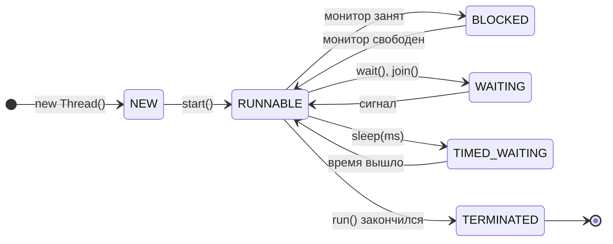
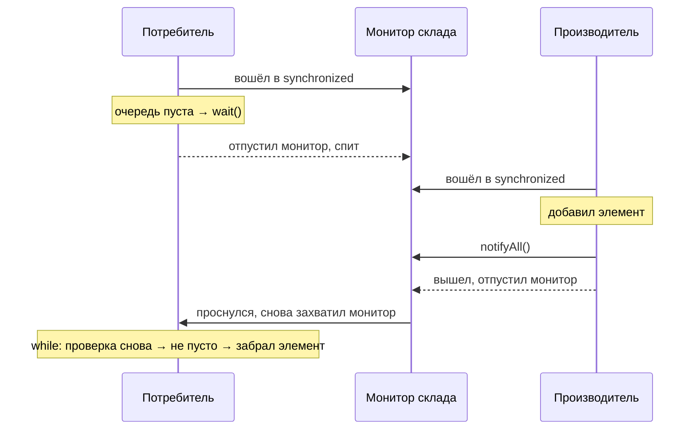

# Многопоточность в Java: краткая теория и полезные примеры

Материал к лабораторной № 9: создание потоков, Producer–Consumer на `wait()` / `notifyAll()`, `ExecutorService`.

---

## 1. Главное за минуту

- **Поток** — отдельная линия выполнения внутри программы. `main` — тоже поток, его создаёт JVM.
- Потоки выполняются **асинхронно**: порядок их работы определяет планировщик, а не порядок строк в коде. Вывод двух потоков может перемешиваться по-разному при каждом запуске — это нормально.
- Когда потоки работают с **общими данными**, нужна синхронизация, иначе данные портятся.
- Программа завершается, когда закончились все **обычные** (не фоновые) потоки. Поток, который ждёт вечно, не даст программе завершиться.

---

## 2. Создание и запуск потока

### Способ 1: подкласс `Thread`

```java
class HelloThread extends Thread {
    @Override
    public void run() {
        System.out.println("Привет из " + getName());
    }
}

Thread t = new HelloThread();
t.start();
```

### Способ 2: `Runnable` (класс или лямбда)

```java
Runnable task = () -> System.out.println("Привет из " + Thread.currentThread().getName());
Thread t = new Thread(task, "Мой-поток");   // второй параметр — имя потока
t.start();
```

`Runnable` — это «что сделать», `Thread` — «кто сделает». Обычно предпочтительнее `Runnable`: класс остаётся свободным для наследования, а задачу можно отдать и в `Thread`, и в пул потоков.

### `start()`, а не `run()`

```java
t.run();     // НЕТ: обычный вызов метода, код выполнится в текущем потоке (main)
t.start();   // ДА: создаётся новый поток, и уже в нём вызывается run()
```

Проверить себя: выведите `Thread.currentThread().getName()` внутри `run()`. Если там `main` — вы вызвали `run()`.

`start()` можно вызвать у потока только один раз. Повторный вызов — `IllegalThreadStateException`.

### Подождать завершения: `join()`

```java
t1.start();
t2.start();
t1.join();   // main ждёт, пока t1 закончит
t2.join();
System.out.println("Оба потока закончили");
```

Без `join()` последняя строка, скорее всего, выведется раньше, чем потоки закончат работу.

---

## 3. Состояния потока



| Переход | Когда |
|---|---|
| RUNNABLE → BLOCKED | поток хочет войти в `synchronized`, а монитор занят другим потоком |
| RUNNABLE → WAITING | `wait()`, `join()` без таймаута; выход — `notify()` / `notifyAll()` или завершение потока, которого ждали |
| RUNNABLE → TIMED_WAITING | `sleep(ms)`, `wait(ms)`, `join(ms)`; выход — по истечении времени или по сигналу |

- **BLOCKED** — ждёт возможности войти в `synchronized` (монитор занят другим потоком).
- **WAITING** — ждёт сигнала от другого потока (`wait()`, `join()`).
- Узнать состояние: `thread.getState()`.

---

## 4. Пауза, остановка и прерывание

### `sleep`

```java
Thread.sleep(500);   // усыпляет ТЕКУЩИЙ поток на 500 мс
```

Метод статический: `otherThread.sleep(500)` всё равно усыпит текущий поток, а не `otherThread`.

### Остановка флагом — только с `volatile`

```java
class Worker implements Runnable {
    private volatile boolean active = true;   // volatile обязателен

    public void stop() { active = false; }

    @Override
    public void run() {
        while (active) {
            // работа
        }
    }
}
```

Без `volatile` поток может так и не увидеть, что другой поток поменял флаг: значение остаётся в кеше ядра.

### Прерывание `interrupt()`

`interrupt()` — это **просьба** остановиться, а не приказ. Поток сам решает, когда выйти.

```java
while (!Thread.currentThread().isInterrupted()) {
    try {
        Thread.sleep(100);
    } catch (InterruptedException e) {
        // Пока поток спал, флаг прерывания превратился в исключение и СБРОСИЛСЯ.
        // Восстанавливаем его, иначе while его не увидит и поток не остановится.
        Thread.currentThread().interrupt();
    }
}
```

### Что делать с `InterruptedException`

| Ситуация | Что делать |
|---|---|
| Метод может бросить исключение дальше | объявить `throws InterruptedException` — пусть решает вызывающий |
| Внутри `run()` (бросить дальше нельзя) | `Thread.currentThread().interrupt();` и выйти из работы |
| **Нельзя** | пустой `catch` — сигнал остановки молча теряется |

---

## 5. Гонка и `synchronized`

### Гонка (race condition)

```java
if (balance >= amount) {       // 1. проверка
    balance -= amount;         // 2. действие
}
```

Если два потока одновременно прошли проверку до того, как кто-то из них списал деньги, — оба спишут. Даже `count++` — это три шага (прочитать, прибавить, записать), между которыми может вклиниться другой поток.

### `synchronized`

У каждого объекта есть **монитор** («замок»). В блок `synchronized (obj)` одновременно может войти только один поток. Остальные ждут у входа (BLOCKED).

```java
synchronized (account) {            // блок: замок на объекте account
    account.withdraw(1000);
}

public synchronized void withdraw(int amount) {   // метод: замок на this
    ...
}
```

`synchronized`-метод — то же самое, что `synchronized (this) { ... }` вокруг всего тела. Все synchronized-методы одного объекта используют **один и тот же** замок: пока поток внутри одного из них, в другие тоже никто не войдёт.

---

## 6. `wait()` и `notifyAll()`

Нужны, когда поток должен **дождаться условия**, которое изменит другой поток: «есть место на складе», «есть заказ в очереди».

### Правила

1. `wait()` и `notifyAll()` вызываются **только внутри `synchronized` на том же объекте**. Иначе — `IllegalMonitorStateException`.
2. `wait()` **отпускает монитор** и засыпает. Это позволяет другому потоку войти и изменить условие.
3. Условие ожидания проверяется **в `while`, а не в `if`**: после пробуждения его нужно проверить снова.
4. После изменения общих данных вызывается **`notifyAll()`**, а не `notify()`.

### Шаблон

```java
public synchronized void waitAndAct() throws InterruptedException { //ждатьИДействовать
    while (!canAct()) {   // while! можноДействовать
        wait();                     // отпустить замок и ждать
    }
    act();                  // действовать изменить общие данные
    notifyAll();                    // разбудить всех, кто ждёт изменений
}
```

### Почему `while`, а не `if`

- `notifyAll()` будит **всех** ждущих. Первый проснувшийся мог уже «забрать» условие, остальным оно больше не выполняется.
- Бывают **ложные пробуждения**: `wait()` иногда возвращается без всякого `notify`.

С `if` поток, проснувшись, не проверит условие повторно и, например, попытается взять элемент из пустой очереди.

### Почему `notifyAll()`, а не `notify()`

`notify()` будит **один произвольный** поток. При нескольких производителях и потребителях потребитель может разбудить другого потребителя вместо производителя. Тот проверит условие, увидит пустую очередь и снова уснёт — сигнал потерян, все ждут вечно. На демонстрации с двумя производителями и двумя потребителями `notify()` зависает почти всегда, `notifyAll()` — никогда.

### Как это работает во времени



### Очередь FIFO

```java
private final List<Order> orders = new LinkedList<>();

orders.add(order);          // в конец
Order first = orders.remove(0);   // из начала — первым пришёл, первым ушёл
```

### Согласуйте количество

Если потребители в сумме хотят забрать больше элементов, чем произведёт производитель, лишние будут ждать вечно — и программа не завершится. При 5 заказах на потребителя и *n* заказах потребителей должно быть ровно *n* / 5.

---

## 7. `ExecutorService` — пул потоков

Пул — это готовый набор рабочих потоков и очередь задач. Вы отправляете задачи, пул сам распределяет их по потокам.

### Виды пулов

| Пул | Потоков | Когда |
|---|---|---|
| `Executors.newSingleThreadExecutor()` | 1 | задачи строго по очереди, в порядке отправки |
| `Executors.newFixedThreadPool(n)` | n | ограниченное число одновременных задач |
| `Executors.newCachedThreadPool()` | сколько нужно | много коротких задач; свободные потоки переиспользуются |

### `Runnable` и `Callable`

```java
ExecutorService pool = Executors.newFixedThreadPool(3);

pool.submit(() -> System.out.println("Runnable: ничего не возвращает"));

Future<Integer> future = pool.submit(() -> {       // Callable: есть return
    Thread.sleep(100);                              // можно бросать проверяемые исключения
    return 42;
});
int result = future.get();                          // ждёт, пока задача выполнится
```

Как Java отличает: если в лямбде есть `return значение` — это `Callable`. Удобный приём, когда метод бросает `InterruptedException`, а результат не нужен:

```java
pool.submit(() -> {
    someMethodThatThrowsInterruptedException();
    return null;            // делает лямбду Callable: исключение не нужно ловить здесь
});
```

`future.get()` пробрасывает исключение, случившееся в задаче, завернув его в `ExecutionException`. Вариант с таймаутом — `future.get(10, TimeUnit.SECONDS)`.

### Завершение пула

```java
pool.shutdown();                                       // новых задач не принимать (НЕ ждёт!)
if (!pool.awaitTermination(30, TimeUnit.SECONDS)) {    // ждать уже отправленные
    pool.shutdownNow();                                // не успели — прервать (interrupt всем)
}
```

Если забыть `shutdown()`, программа не завершится: рабочие потоки пула ждут новых задач.

С Java 19 пул можно закрыть через try-with-resources: `close()` вызывает `shutdown()` и ждёт все задачи.

```java
try (ExecutorService pool = Executors.newFixedThreadPool(2)) {
    pool.submit(...);
}   // здесь все задачи уже выполнены
```

### Главная ловушка: голодание пула

```java
ExecutorService pool = Executors.newSingleThreadExecutor();
pool.submit(() -> queue.take());     // ждёт элемент и держит ЕДИНСТВЕННЫЙ поток
pool.submit(() -> queue.put(42));    // никогда не получит поток → вечное ожидание
```

Если задачи в пуле **ждут друг друга**, может случиться так, что все потоки пула заняты ожиданием, а задача, которая должна их разбудить, стоит в очереди пула. Увеличение размера пула не решает проблему надёжно.

**Правило:** задачи, которые производят, и задачи, которые потребляют, — в **разных** пулах.

---

## 8. Запуск через Maven

Удобно добавить в `pom.xml` плагин `exec-maven-plugin` и запускать каждое задание своей командой:

```
mvn compile exec:java -Dexec.mainClass=lab9.task1.Main
mvn compile exec:java -Dexec.mainClass=lab9.task2.Main -Dexec.args=20
```

`-Dexec.args` передаёт аргументы в `main(String[] args)`. Эти команды нужно указать в своём `README.md`.

---

## 9. Частые ошибки

| Ошибка | Признак | Исправление |
|---|---|---|
| `run()` вместо `start()` | всё выполняется в потоке `main`, по порядку | `start()` |
| `wait()` вне `synchronized` | `IllegalMonitorStateException` | вызывать внутри `synchronized` на том же объекте |
| `wait()` и `notifyAll()` на разных объектах | потоки не просыпаются | один монитор: например, оба метода склада `synchronized` |
| `if` вместо `while` перед `wait()` | редкие ошибки: элемент из пустой очереди, переполнение | `while` |
| `notify()` при нескольких потребителях | программа иногда зависает | `notifyAll()` |
| Потребителей больше, чем нужно | программа не завершается | согласовать *n* и число потребителей |
| Пустой `catch (InterruptedException e) {}` | поток не останавливается по `interrupt()` | восстановить флаг или пробросить |
| Флаг остановки без `volatile` | поток не останавливается | `volatile boolean` |
| Один пул для отправки и обработки | программа зависает | разные пулы |
| Нет `shutdown()` | программа не завершается после работы | `shutdown()` + `awaitTermination()` или try-with-resources |
| `shutdown()` без ожидания | итог печатается до окончания задач | `awaitTermination()` или `future.get()` |

---

## 10. Самопроверка

1. Что выведет программа, если вместо `start()` вызвать `run()`? В каком потоке выполнится код?
2. Чем состояние BLOCKED отличается от WAITING?
3. Почему `wait()` проверяют в `while`?
4. Что делает `wait()` с монитором? Почему это важно для Producer–Consumer?
5. Почему `notifyAll()` надёжнее `notify()`?
6. Чем `Callable` отличается от `Runnable`?
7. Что делает `shutdown()` и чего он не делает?
8. Почему задачи, которые ждут друг друга, нельзя отправлять в один маленький пул?
