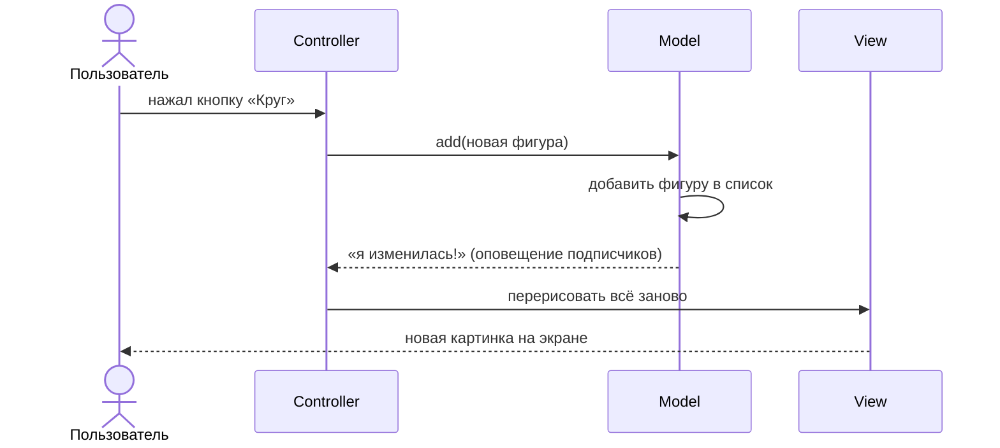

# Паттерн MVC в JavaFX: краткая теория и полезные примеры

Материал к лабораторной «JavaFX 2» (фигуры на холсте, перетаскивание мышью).

---

## 1. Зачем вообще паттерн

Пока окно маленькое, весь код удобно писать в контроллере. Но попробуйте в одном классе:
- хранить фигуры;
- искать, по какой фигуре щёлкнули;
- помнить порядок наложения;
- рисовать;
- обрабатывать мышь.

Получится класс на сотни строк, в котором любое изменение задевает всё остальное, а проверить логику можно только запустив окно и пощёлкав мышью.

**Паттерн проектирования** — это проверенный способ разложить код по местам, чтобы так не получалось.

---

## 2. MVC за одну минуту

**MVC = Model, View, Controller.** Программа делится на три части с разными обязанностями.

| Часть | Что делает | Чего НЕ делает | В нашей задаче |
|---|---|---|---|
| **Model** (модель) | хранит данные и правила работы с ними | ничего не знает об окне, кнопках, мыши | список фигур, порядок наложения, «какая фигура под точкой» |
| **View** (представление) | показывает текущее состояние модели | ничего не решает | FXML-разметка, рисование фигур на холсте |
| **Controller** (контроллер) | принимает действия пользователя и превращает их в команды модели | не хранит данные приложения, не рисует | обработчики кнопок и мыши |

### Как идут данные



Читать сверху вниз: каждая стрелка — следующий шаг. Пунктирная стрелка от модели — оповещение: модель не знает, кто её слушает, она просто вызывает всех подписчиков.

**Главное правило:** контроллер не рисует. Он меняет модель, а картинка обновляется по оповещению от модели в одном месте.

### Аналогия

Ресторан. **Официант** (Controller) принимает заказ и передаёт его на кухню. **Кухня** (Model) знает рецепты и готовит. **Витрина** (View) показывает, что готово. Официант не готовит сам, кухня не выходит в зал, витрина ничего не решает.

---

## 3. Как проверить, что модель отделена правильно

Простые тесты:

1. **В модели нет `import javafx...`.** Ни `Color`, ни `GraphicsContext`, ни `MouseEvent`.
2. **Модель можно проверить без окна.** Написать `main` или тест, создать модель, добавить фигуры, вызвать поиск. Если для этого нужен `Stage` — модель не отделена.
3. **Замена View не трогает модель.** Если завтра рисовать в консоль вместо холста, классы модели не меняются.

---

## 4. Паттерн «Наблюдатель»: как View узнаёт об изменениях

Модель не знает, кто её показывает. Она просто держит список подписчиков и при каждом изменении всех вызывает.

```java
public class Counter {                         // пример модели, не из задания
    private int value;
    private final List<Runnable> listeners = new ArrayList<>();

    public void addListener(Runnable listener) {
        listeners.add(listener);
    }

    public int getValue() { return value; }

    public void increment() {
        value++;
        fireChanged();                         // каждое изменение — оповещение
    }

    private void fireChanged() {
        for (Runnable listener : listeners) {
            listener.run();
        }
    }
}
```

Подписка в контроллере:

```java
counter.addListener(this::refresh);            // при изменении вызвать refresh()

private void refresh() {
    label.setText(String.valueOf(counter.getValue()));
}
```

Вы уже пользовались этим паттерном: `textProperty().addListener(...)`, `ListChangeListener`.

---

## 5. Особенность JavaFX: кто такой «контроллер» из FXML

Класс в `fx:controller` называется контроллером, но он держит ссылки на элементы окна (`@FXML Label`, `@FXML Canvas`), то есть частично относится к View. Это нормально.

Важно другое: **данные и правила не должны жить в нём.** Список фигур, поиск, порядок наложения — в модели.

### Как передать модель в контроллер

Если у контроллера конструктор с параметрами, `FXMLLoader` сам его не создаст. Подскажите ему:

```java
DrawingModel model = new DrawingModel();

FXMLLoader loader = new FXMLLoader(App.class.getResource("main-view.fxml"));
loader.setControllerFactory(type -> new MainController(model));
stage.setScene(new Scene(loader.load()));
```

```java
public class MainController {
    private final DrawingModel model;

    public MainController(DrawingModel model) {
        this.model = model;
    }
}
```

Так модель создаётся снаружи и может быть общей для нескольких окон.

---

## 6. Полезные примеры для лабораторной

### 6.1. Canvas: рисование

```java
GraphicsContext gc = canvas.getGraphicsContext2D();

gc.setFill(Color.WHITE);                       // очистить холст
gc.fillRect(0, 0, canvas.getWidth(), canvas.getHeight());

gc.setFill(Color.rgb(200, 80, 80));            // цвет заливки
gc.setStroke(Color.BLACK);                     // цвет контура
gc.setLineWidth(1.5);

gc.fillRect(x, y, width, height);              // прямоугольник: (x, y) — левый верхний угол
gc.strokeRect(x, y, width, height);

// Овал: (x, y) — левый верхний угол ОПИСАННОГО квадрата, а не центр!
gc.fillOval(cx - r, cy - r, 2 * r, 2 * r);

double[] xs = {10, 60, 110};
double[] ys = {100, 20, 100};
gc.fillPolygon(xs, ys, 3);                      // многоугольник по вершинам
```

**Важно:** Canvas — это пиксели. Нарисованный круг не объект, его нельзя «найти» или сдвинуть. Поэтому:
- фигуры хранятся в модели;
- при любом изменении холст очищается и **все** фигуры рисуются заново, снизу вверх.

### 6.2. Холст, который растягивается вместе с окном

Canvas сам не меняет размер. Положите его в `Pane` и привяжите размер:

```java
canvas.widthProperty().bind(canvasHolder.widthProperty());
canvas.heightProperty().bind(canvasHolder.heightProperty());

// при изменении размера содержимое стирается — перерисовать
canvas.widthProperty().addListener(o -> refresh());
canvas.heightProperty().addListener(o -> refresh());
```

У `Pane` в FXML поставьте `minWidth="0" minHeight="0"`, чтобы окно можно было уменьшать.

### 6.3. События мыши

В FXML на холсте:

```xml
<Canvas fx:id="canvas"
        onMousePressed="#onMousePressed"
        onMouseDragged="#onMouseDragged"
        onMouseReleased="#onMouseReleased"/>
```

В контроллере:

```java
@FXML
private void onMousePressed(MouseEvent e) {
    double x = e.getX();                      // координаты относительно холста
    double y = e.getY();

    if (e.getButton() == MouseButton.PRIMARY) {
        // левая кнопка
    } else if (e.getButton() == MouseButton.SECONDARY) {
        // правая кнопка
    }
}
```

| Событие | Когда приходит |
|---|---|
| `MOUSE_PRESSED` | кнопку нажали |
| `MOUSE_DRAGGED` | мышь двигается с зажатой кнопкой (приходит много раз) |
| `MOUSE_RELEASED` | кнопку отпустили |
| `MOUSE_CLICKED` | нажали и отпустили на месте (для перетаскивания не подходит) |

### 6.4. Перетаскивание без «прыжка»

Если ставить фигуру центром в курсор, фигура, взятая за край, прыгнет. Двигайте на **смещение мыши**:

```java
private double lastX, lastY;                   // где была мышь в прошлый раз

// при нажатии:
lastX = e.getX();
lastY = e.getY();

// при перетаскивании:
double dx = e.getX() - lastX;
double dy = e.getY() - lastY;
lastX = e.getX();
lastY = e.getY();
// сдвинуть фигуру на (dx, dy)
```

Не забудьте при отпускании сбросить ссылку на перетаскиваемую фигуру, иначе фигура поедет при следующем движении с зажатой кнопкой.

### 6.5. Попадание точки в фигуру

**Круг:** расстояние до центра не больше радиуса. Сравниваем квадраты, корень не нужен.

```java
double dx = px - cx;
double dy = py - cy;
boolean inside = dx * dx + dy * dy <= r * r;
```

**Прямоугольник** (стороны параллельны осям):

```java
boolean inside = px >= x && px <= x + width && py >= y && py <= y + height;
```

**Треугольник** (подсказка): точка внутри, если она лежит **по одну сторону** от каждой из трёх сторон. С какой стороны от отрезка `AB` лежит точка `P`, показывает знак векторного произведения:

```java
double cross = (bx - ax) * (py - ay) - (by - ay) * (px - ax);
// > 0 — с одной стороны, < 0 — с другой, 0 — на прямой
```

Посчитайте его для сторон `AB`, `BC`, `CA`. Если среди трёх чисел есть и положительные, и отрицательные — точка снаружи.

### 6.6. Порядок наложения через список

Храните фигуры в списке: **индекс 0 — самая нижняя, последняя — самая верхняя**. Рисуйте по порядку, тогда последняя окажется сверху.

**Найти верхнюю фигуру под точкой** — обходить с конца:

```java
for (int i = items.size() - 1; i >= 0; i--) {
    if (items.get(i).contains(x, y)) {
        return items.get(i);
    }
}
return null;   // или Optional.empty()
```

**Поднять фигуру наверх, не нарушая порядок остальных:**

```java
items.remove(item);   // остальные сдвинулись, их взаимный порядок не изменился
items.add(item);      // в конец = наверх
```

Проверьте на бумаге со списком `[A, B, C, D]` и поднимите `B`:
- `remove + add` даёт `[A, C, D, B]` — верно;
- обмен `B` с последним даёт `[A, D, C, B]` — `C` и `D` поменялись местами, это нарушает условие.

### 6.7. Случайная фигура внутри холста

Случайную точку выбирайте с учётом размера фигуры:

```java
Random random = new Random();

double size = 20 + random.nextDouble() * 60;              // размер от 20 до 80
double x = random.nextDouble() * (canvasWidth - size);    // фигура не вылезет справа
double y = random.nextDouble() * (canvasHeight - size);   // и снизу
```

Для круга с центром `(cx, cy)` центр выбирается в диапазоне `[r, width − r]`.

Случайный цвет:

```java
int r = random.nextInt(256), g = random.nextInt(256), b = random.nextInt(256);
```

**Совет:** передавайте `Random` в конструктор класса-генератора. В тесте `new Random(42)` даст одинаковые «случайные» фигуры при каждом запуске.

### 6.8. Цвет в модели без JavaFX

Чтобы модель не зависела от JavaFX, храните цвет своим типом:

```java
public record Rgb(int red, int green, int blue) { }
```

А в View переводите:

```java
Color color = Color.rgb(rgb.red(), rgb.green(), rgb.blue());
```

### 6.9. Фигура + цвет: композиция

Фигура из `geometry2d` не должна знать про цвет. Объедините их в отдельном классе:

```java
public class ShapeItem {
    private final Figure figure;    // «имеет» фигуру
    private Rgb color;              // и цвет
    // ...
}
```

Это та же идея, что `Cylinder` из лабораторной №2: цилиндр *имеет* основание, а не *является* им.

### 6.10. Рисование разных фигур

Если метода `draw()` в `Figure` нет (а в MVC его лучше не добавлять, чтобы `geometry2d` не зависел от JavaFX), View выбирает способ рисования по типу:

```java
if (figure instanceof Circle c) {
    // рисуем круг, переменная c уже нужного типа
} else if (figure instanceof Rectangle r) {
    // рисуем прямоугольник
}
```

---

## 7. Тестирование модели (по желанию, бонус)

Модель без JavaFX проверяется обычным JUnit, без окна:

```java
@Test
void bringToFrontKeepsOrderOfOthers() {
    DrawingModel model = new DrawingModel();
    model.add(a);
    model.add(b);
    model.add(c);

    model.bringToFront(a);

    assertEquals(List.of(b, c, a), model.getItems());
}
```

В IntelliJ IDEA: Alt+Enter на имени класса → **Create Test** → JUnit 5.

---

## 8. Частые ошибки

| Ошибка | Признак | Как исправить |
|---|---|---|
| Список фигур в контроллере | модель пустая или её нет | перенести данные и поиск в класс модели |
| Рисование прямо в обработчике кнопки | после перетаскивания на холсте остаются «следы» | кнопка меняет модель, картинка перерисовывается целиком по оповещению |
| Берётся нижняя фигура | щелчок по перекрытию берёт не ту | обходить список с конца |
| Поднятие через обмен | порядок остальных фигур меняется | `remove` + `add` |
| Круг рисуется не там, где ловится мышью | промахи по краю круга | `fillOval(cx − r, cy − r, 2r, 2r)` |
| Фигура вылезает за холст | часть фигуры обрезана | учитывать размер при выборе случайной точки |
| Фигура прыгает при захвате | центр фигуры встаёт под курсор | двигать на смещение мыши |
| `import javafx` в модели | модель нельзя проверить без окна | свой тип цвета, рисование в View |

---

## 9. Самопроверка

1. Где хранятся фигуры в вашей программе?
2. Можно ли проверить поиск фигуры под точкой без запуска окна?
3. Что изменится в коде, если добавить кнопку «Эллипс»? Должны меняться только `geometry2d`, рисование, кнопка и её обработчик.
4. Как View узнаёт, что пора перерисоваться?
5. Где хранится, какую фигуру вы сейчас тащите? Почему не в модели?
